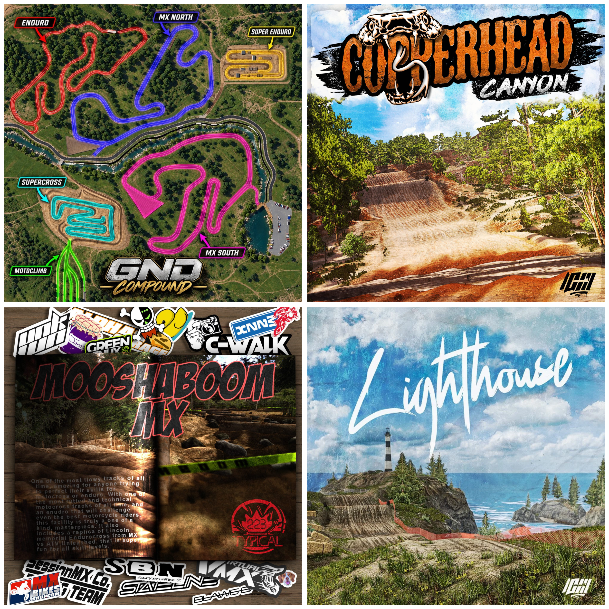

# MXB Track Finder
This aims to be a helpful tool to make life easier when searching for new tracks to play.

# MX Bikes Shop

<a href="https://mxbikes-shop.com" target="_blank" rel="noopener noreferrer">
  <picture>
    
  </picture>
</a>

## 🏁 [Enduro](https://github.com/BrinkleyPT/MXBTrackFinder/blob/main/MX%20Bikes%20Shop/Tracks/Enduro/README.md)

<a href="https://github.com/BrinkleyPT/MXBTrackFinder/blob/main/MX%20Bikes%20Shop/Tracks/Enduro/README.md" target="_blank" rel="noopener noreferrer">
  <picture>
    
  </picture>
</a>
